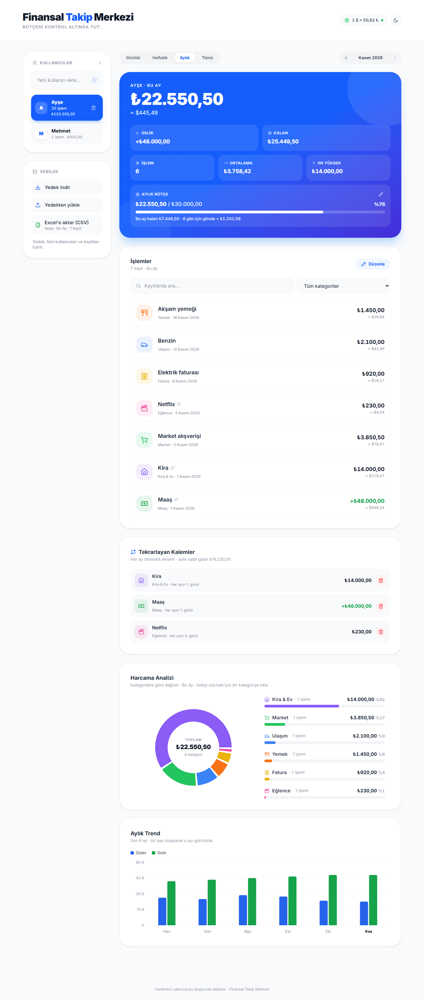
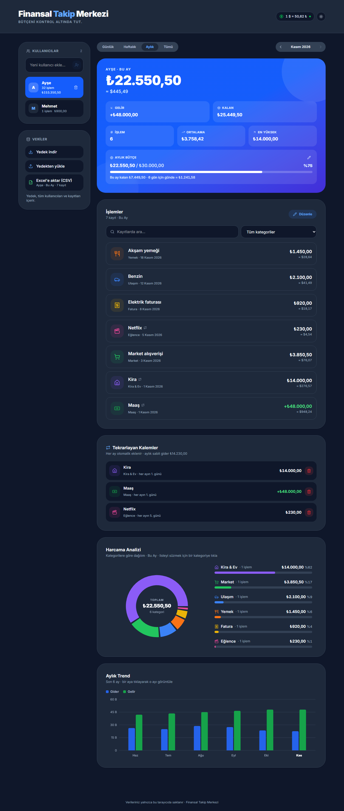

# Finansal Takip Merkezi 💰

<p align="center">
  
  
</p>

### 🎯 Hızlı Bakış
**Finansal Takip Merkezi**, karmaşık finansal tablolardan kurtulmanı sağlayan; gelir ve giderlerini saniyeler içinde kaydedip, görsel grafiklerle bütçe disiplinini korumana yardımcı olan modern bir kişisel finans yönetim arayüzüdür. Üyelik gerektirmez, verilerin yalnızca kendi tarayıcında durur.

## 🔗 Canlı Demo
Uygulamanın güncel haline buradan ulaşabilirsiniz:
👉 [https://delicate-boba-47275e.netlify.app/](https://delicate-boba-47275e.netlify.app/)

## ✨ Özellikler

**Kayıt tutma**
* **Gelir ve gider takibi:** Her kayıt için ad, tutar, tarih ve kategori. Tutarı `20$` biçiminde yazarsan güncel kurla TL'ye çevrilir.
* **Akıllı kategoriler:** Kategori, kaydın adından otomatik tahmin edilir ("Migros" → Market); istersen elle değiştirirsin.
* **Tekrarlayan kalemler:** Kira, fatura, abonelik, maaş gibi kayıtları bir kez tanımla, her ay aynı gün otomatik eklensin.
* **Çoklu kullanıcı:** Aile üyeleri ya da farklı bütçeler için ayrı ayrı kullanıcılar.

**Bütçe ve analiz**
* **Aylık bütçe limiti:** Limitin ne kadarını harcadığını, ne kadar kaldığını ve ay sonuna kadar günde ne kadar harcayabileceğini gösterir; çubuk limite yaklaşınca sarıya, aşılınca kırmızıya döner.
* **Kategori dağılımı:** Harcamaların kategorilere göre pasta grafiği. Bir kategoriye tıklayınca liste o kategoriye süzülür.
* **Aylık trend:** Son 6 ayın gelir ve gider karşılaştırması. Bir aya tıklayınca o ay açılır.
* **Dönem seçimi:** Günlük, haftalık, aylık ya da tüm zamanlar; aylık görünümde geçmiş aylar arasında gezinme.
* **Arama ve süzme:** Kayıtlarda ada ya da kategoriye göre arama.

**Veri ve kullanım**
* **Yedekleme:** Tüm veriyi tek dosya olarak indir, başka bir cihazda ya da tarayıcıda geri yükle.
* **Excel'e aktarma:** Görüntülenen kayıtları Excel'in doğrudan açtığı CSV dosyası olarak indir.
* **Karanlık tema:** Tek tıkla açık/koyu tema; ilk açılışta cihazının tercihini kullanır.
* **Kurulabilir ve çevrimdışı:** Telefona ya da masaüstüne uygulama gibi kurulur, bir kez açıldıktan sonra internet olmadan da çalışır.
* **Canlı dolar kuru:** Tutarların dolar karşılığı güncel kurla gösterilir; kur servisi yanıt vermezse son alınan kur kullanılır.

## 💡 Projenin Amacı
Modern dünyada kişisel bütçeyi yönetmek, harcamaları anlık görebilmek ve gelecek planlaması yapmak oldukça kritiktir. Bu uygulama, kullanıcıların karmaşık finansal tablolarla uğraşmadan gelir ve giderlerini sisteme girmelerini ve bunların bütçeleri üzerindeki etkisini görsel olarak analiz etmelerini hedefler.

## 🚀 Kurulum
Bilgisayarında çalıştırmak için güncel bir [Node.js](https://nodejs.org/) LTS sürümü yeterlidir:

```bash
git clone https://github.com/kadirppkr53/finansal-takip-merkezi.git
cd finansal-takip-merkezi
npm install
npm run dev
```

| Komut | Ne yapar |
|---|---|
| `npm run dev` | Geliştirme sunucusunu başlatır |
| `npm run build` | Yayın için `dist/` klasörüne derler |
| `npm run preview` | Derlenmiş sürümü yerelde sunar (çevrimdışı çalışma yalnızca burada ve canlıda etkindir) |
| `npm run lint` | Kod denetimini çalıştırır |

Herhangi bir API anahtarı ya da `.env` dosyası gerekmez.

## ⚙️ Teknik Mimari
Projemiz, modern bir front-end geliştirme süreciyle inşa edilmiştir; sunucu tarafı yoktur.

1. **Veri Saklama:** Tüm kayıtlar kullanıcının tarayıcısındaki `LocalStorage` üzerinde tutulur. Sayfayı yenilesen de verilerin kaybolmaz; kayıtların hiçbir sunucuya gönderilmez.
2. **Bileşen Tabanlı Yapı:** Arayüz `React` bileşenlerine bölünmüştür. Hesaplama ve veri işleme mantığı bileşenlerden ayrı, `src/services/` altında saf fonksiyonlar olarak durur.
3. **Dinamik Analiz:** Özet, grafikler ve liste, seçilen döneme göre anlık olarak yeniden hesaplanır.
4. **Tema:** Karanlık tema, bileşenlere tek tek dokunmadan, renk değişkenlerinin `src/index.css` içindeki tek bir blokta koyu karşılıklarına çevrilmesiyle çalışır.
5. **Çevrimdışı Çalışma:** `public/sw.js` içindeki service worker uygulamanın kendi dosyalarını önbelleğe alır; yeni sürüm yayınlandığında sayfa ağdan güncel haliyle gelir.

```
src/
├── pages/Dashboard.jsx      Ana ekran: durum yönetimi ve bileşenlerin birleşimi
├── components/              Form, liste, grafikler, paneller
└── services/
    ├── api.js               Saklama, kur, dönem süzme, biçimlendirme
    ├── kategoriler.js       Gelir/gider kategorileri ve addan tahmin
    ├── tekrar.js            Tekrarlayan kalemlerin işlenmesi
    ├── veri.js              Yedekleme ve CSV dışa aktarma
    └── tema.js              Açık/koyu tema
```

## 📈 Veri Akışı
Uygulamanın kalbinde basit ama etkili bir veri döngüsü bulunur:
* **Girdi:** Form aracılığıyla gelir ya da gider kaydı alınır.
* **İşleme:** Kayıt `State` içine alınır, `LocalStorage`'a yazılır ve seçili döneme göre toplamlar hesaplanır.
* **Görselleştirme:** İşlenmiş veriler özet kartına ve grafik bileşenlerine aktarılarak bütçe durumunu özetler.

## 🛠 Neden Bu Teknolojiler?
* **React + Vite:** Hızlı derleme ve kullanıcı dostu geliştirme süreci için tercih edildi.
* **Tailwind CSS:** Tasarım tutarlılığını sağlamak ve modern arayüzleri hızlıca kurgulamak için seçildi.
* **Recharts:** Pasta ve çubuk grafikleri React bileşenleri olarak, etkileşimli biçimde çizmek için kullanıldı.
* **Netlify:** Projeyi tek tıkla dünyanın her yerine güvenli ve hızlı bir şekilde yayınlamak için kullanıldı.

## 🔭 Gelecek Vizyonu ve Katkı
Uygulamanın sınırlarını genişletmek ve daha akıllı bir deneyim sunmak için şu fikirler üzerinde çalışılabilir:

* **Finansal Zeka (AI):** Harcama alışkanlıklarını analiz eden ve proaktif önerilerde bulunan bir yapay zeka entegrasyonu.
* **Cihazlar Arası Eşitleme:** Verilerin bir hesapla buluta yedeklenip telefon ve bilgisayar arasında otomatik eşitlenmesi.
* **Çoklu Para Birimi:** Dolar dışında euro, altın gibi birimlerle kayıt ve görüntüleme.
* **Kategori Bazlı Bütçeler:** Toplam limitin yanında her kategori için ayrı limit.
* **Sosyal Hedefler:** Aile üyeleri veya arkadaşlarla ortak bütçe havuzları.

---

### 💡 Nasıl Katkıda Bulunabilirsin?
Senin de bu projenin bir parçası olmanı çok isterim! Eğer bir fikrin varsa veya bir hata keşfettiysen:
1. **Fork** yap,
2. Bir **Branch** oluştur,
3. Değişikliklerini **Commit** et ve bir **Pull Request** gönder.
